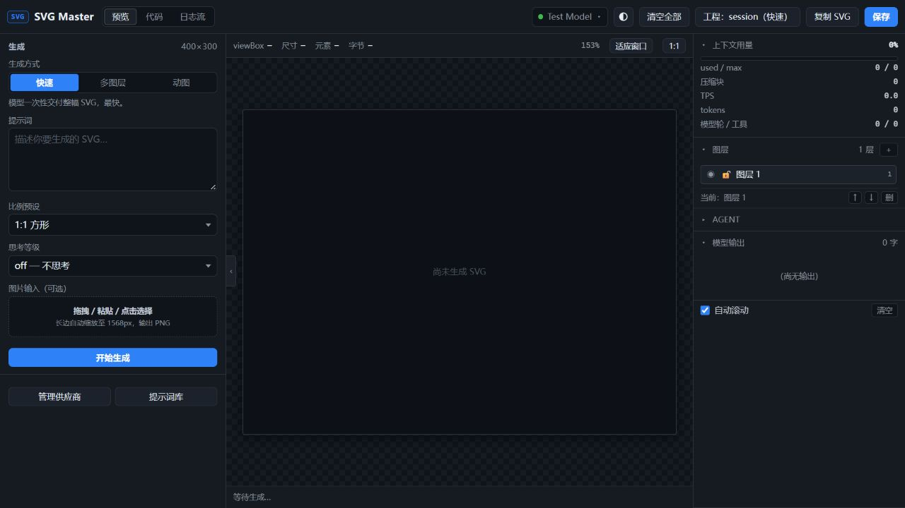

# SVG Master v1.4.1 协议与 Agent 修复

日期：2026-10-24

## 日志对应的原因

1. 成功执行 `emit_svg` 后，系统仍会请求模型收尾。系统提示要求通过工具交付，因此模型正常结束时可能没有正文；旧逻辑把这种情况当成空回复，额外重试两次。
2. Responses 历史只保留可见文字和重建的工具调用，丢失加密 reasoning、原始 item ID、assistant phase 等续传字段。
3. Responses 的 `incomplete`、部分协议的输出截断以及流提前 EOF 被当作成功；部分 HTTP 200 JSON 错误又被当作空流。
4. HTTP 层和 Agent 层分别重试，持续 HTTP 错误可能被放大到 16 次请求，400 等确定性错误也会再次发送。
5. 停止没有覆盖等待 fetch 响应头的阶段；任务注册后、Engine.Run 之前也有取消窗口。

## 变更

| 范围 | 行为 |
| --- | --- |
| Responses | 原样保留并持久化 output items；续传 reasoning、phase、工具 ID；从完成快照补齐遗漏增量；修复晚到的工具名称/call_id；显式报告 incomplete/failed/refusal。 |
| Chat Completions | 接收晚到的工具元数据；识别 length/content_filter/refusal；正确选择 GPT-6 的 max_completion_tokens。 |
| Anthropic | 保留 thinking/signature/redacted_thinking 与工具输入；旧无签名思考不再编码成非法 thinking block；支持 pause_turn 续接；添加稳定的缓存边界。 |
| Gemini | 保留 thoughtSignature 与原始 parts；无 ID 的同名工具生成不同 ID；流式与 JSON 路径都检查阻断、输出上限；关闭流式时调用 generateContent，接受带 models/ 前缀的模型名。 |
| 公共传输 | 自动识别网关返回的 JSON；检查流结束标志；保留错误分类；非流式读取增加空闲超时与大小上限；复用 HTTP 连接池。 |
| Agent | 成功交付后的无正文收尾正常结束；400/鉴权/无效参数/输出限制等不再盲重试；HTTP 重试耗尽后不再叠加 Agent 重试；中途断流仍保留有限重试；达到步数上限报告未完成。 |
| 历史和用量 | 中止工具批次时为未执行调用补齐取消结果，保证下次续聊配对；原生输出在压缩投影及工程重开后保留；失败响应的已报告用量不再丢失，覆盖四协议非流式截断。 |
| 停止 | 点击即停止；AbortController 覆盖 fetch 全生命周期；后端直接取消请求 context；runId 防止迟到的中止请求影响下一轮；单工程禁止重叠任务。 |

## 清空全部

原“清空上下文”改为“清空全部”，快速模式与工程模式统一生效：

- 先取消任务并等待退出，再清空，避免旧任务回写。
- 清空当前画布、全部图层内容、历史及协议续传数据，重建一个空图层。
- 清空提示词、输入图片、日志、原始输出、动画预览、用量及代码视图缓存。
- 清除生成模式的运行锁；拒绝清空前发出的旧校验、工程刷新及待启动回调；清空过程中暂禁启动生成。
- 保留工程位置、画布尺寸、供应商配置及设置。此前导出的独立 SVG 文件保留。

## 验证

- `go test ./...`：通过。
- `go test -race ./...`：通过。
- `go vet ./...`：通过。
- `node --check internal/api/webdist/app.js`：通过。
- Windows GUI 构建：`go build -trimpath -ldflags "-s -w -H windowsgui" -o dist/svg-master/svg-master.exe .`。
- 四协议覆盖：响应头前/后取消、JSON 兜底及错误、截断流、工具续传、原生签名、永久错误分类。
- API 联调覆盖：迟到 abort 不影响新任务、禁止重叠任务、生成中清空、清空后重开工程仍为空。
- 浏览器联调：本机假模型完成 Responses 工具生成；15 秒延迟响应头时一键停止；生成中清空后画布、提示词、输出与用量归零，模式恢复可切换。

复现界面联调，不使用真实 API Key：

```powershell
go run ./test/fake_llm -port 18999
go run ./test/ui_smoke
```

验证等待响应头时的停止，可给 fake_llm 添加 `-delay 15000`；观察兼容协议工具参数增量，可添加 `-slow 300`。ui_smoke 使用独立临时数据目录，并在终端打印界面地址。

## 缓存与验证边界

缓存方面修复了原生历史丢失、随用户提示词变化的重复系统注入，并设置稳定的 Responses prompt_cache_key 和 Anthropic 缓存边界。完整历史、固定工具定义和相同模型/参数有助于保留可复用前缀，但缓存命中率仍取决于实际模型、请求长度、路由和渠道实现。本次未调用收费模型，未测量真实渠道的命中率变化。

取消会终止本地请求并阻止后续重试；上游服务若忽略客户端断连，已经接收的生成仍可能继续运行或留下日志。

本次用到的 OpenAI Docs：

- [Function calling](https://developers.openai.com/api/docs/guides/function-calling)
- [Reasoning models](https://developers.openai.com/api/docs/guides/reasoning)
- [Prompt caching](https://developers.openai.com/api/docs/guides/prompt-caching)


